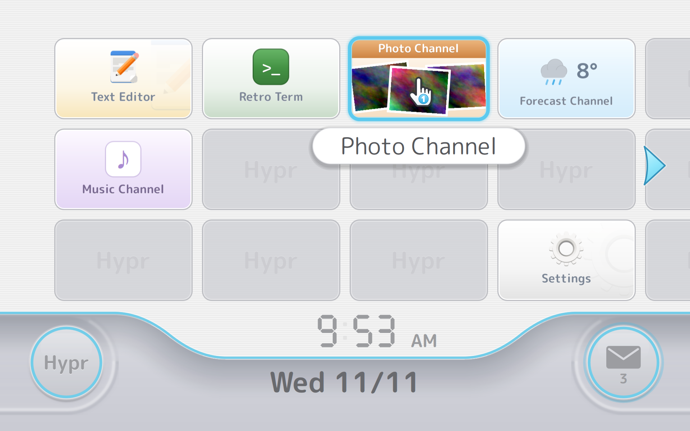
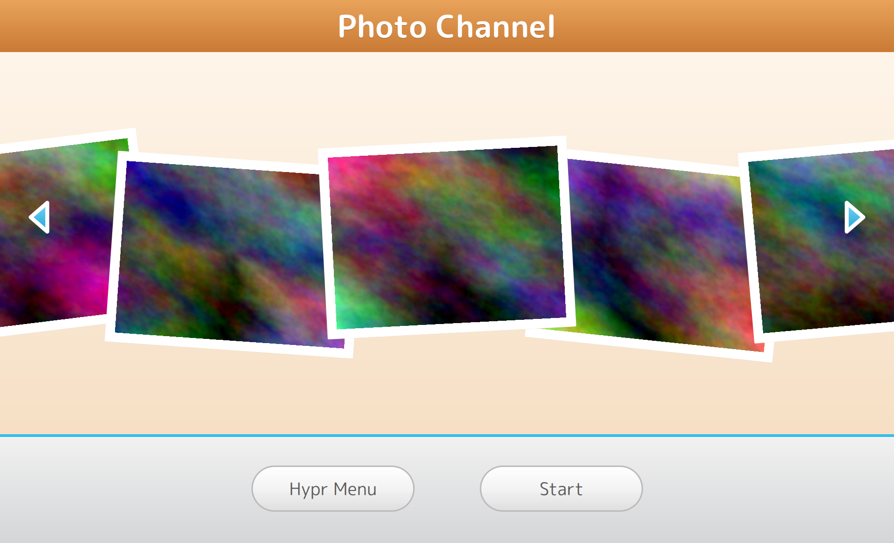
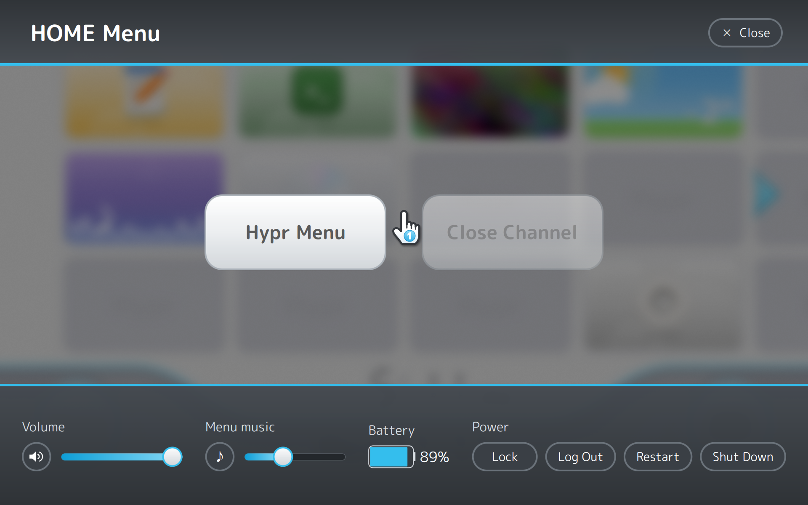
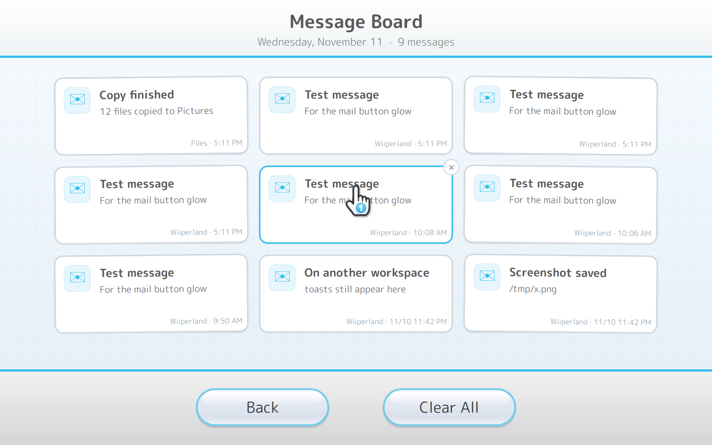

# Wiiperland

A [Hyprland](https://hypr.land) desktop that looks and feels like the Wii home
menu, built with Hyprland's Lua config and a [Quickshell](https://quickshell.org)
shell.



- **The menu**: a white, finely striped home screen with pages of 4×3
  rounded channel tiles that run edge to edge (the next page peeks in), name
  bubbles on hover, a curved pale grey bottom bar, a segment clock with a
  blinking colon, the date, and round buttons in the corners.
- **Channels**: click a tile and it grows into a "TV" panel preview with
  **Menu** and **Start**. Start fades to white and opens the app on its own
  workspace, or jumps to it if it's already running.
- **Banners**: every tile is a full-bleed, gently moving scene. Drop your own
  picture, gif or video (and a jingle) into the asset folder to replace one.
- **Live channels**: a Photo Channel slideshow of your pictures, a Forecast
  Channel with a sky for the current weather (wttr.in, three-day preview), a
  Music Channel (any MPRIS player, with controls) and a Disc Channel for the
  USB stick, SD card or disc you plug in.
- **Arrange it from the menu**: hold a tile and drag it to another slot,
  click an empty slot to add a channel, right-click to move or remove one.
- **Message Board**: Wiiperland is your notification server. Toasts drop in,
  the mail button glows with the unread count, and every message is kept on
  a graph-paper board.
- **HOME Menu** (SUPER+ESC) from anywhere: back to the menu, close the
  channel, volume, menu music, battery and power.
- **Feel**: soft original UI sounds and quiet menu music that makes way for
  your own audio, a pointing-hand cursor, windows that zoom in with a little
  overshoot, a blue glow on the focused window, a "Welcome" screen on the
  first start of the day and a matching lock screen.

| Channel preview | HOME Menu | Message Board |
|---|---|---|
|  |  |  |

## Install
Requirements: Arch Linux (or anything with the same packages), **Hyprland
0.57+** and **Quickshell 0.3+**.

```bash
git clone <this repo> ~/Wiiperland
cd ~/Wiiperland
./install.sh --deps      # installs missing packages with pacman, then sets up
```

The installer backs up your current `~/.config/hypr/hyprland.lua` /
`hyprland.conf`, writes a new `hyprland.lua` that loads Wiiperland from the
repo, creates `~/.config/wiiperland/config.json`, and links the cursor and
font. Log out and pick Hyprland. `./uninstall.sh` puts everything back.
Details: [docs/install.md](docs/install.md).

## Using it
| Keys | Action |
|---|---|
| SUPER (tap) | Back to the menu |
| SUPER+ESC | HOME Menu |
| SUPER+RETURN / B / E | Terminal / browser / files |
| SUPER+Q | Close window |
| SUPER+TAB | Next channel |
| SUPER+L | Lock |

All bindings: [docs/hyprland.md](docs/hyprland.md#key-bindings).
Arrange channels right on the menu (drag, click an empty slot, right-click),
or edit `~/.config/wiiperland/config.json`; the menu updates as soon as you
save. See [docs/channels.md](docs/channels.md).

## Docs
- [Install](docs/install.md)
- [Hyprland config](docs/hyprland.md)
- [Quickshell shell](docs/shell.md)
- [Channels and config.json](docs/channels.md)
- [Channel preview and launching](docs/preview-and-launch.md)
- [Your own assets (sounds, music, fonts, images, banners)](docs/assets.md)
- [Sounds and music](docs/sounds.md)
- [Message Board](docs/messages.md)
- [HOME Menu and volume](docs/home-menu.md)
- [Lock screen and welcome screen](docs/lock-and-startup.md)
- [Cursor](docs/cursor.md)
- [Development and testing](docs/development.md)
- [Roadmap](ROADMAP.md)

## Credits and licences
- Code: MIT ([LICENSE](LICENSE)).
- Sounds, menu music and cursor: original, generated by
  `tools/make-sounds.py`, `tools/make-music.py` and `tools/make-cursor.py`,
  CC0.
- Font: [M PLUS Rounded 1c](https://fonts.google.com/specimen/M+PLUS+Rounded+1c),
  SIL Open Font License ([OFL.txt](quickshell/assets/fonts/OFL.txt)).

This is a fan-made look-alike. It is not affiliated with or endorsed by
Nintendo, and it contains no Nintendo artwork, logos, sounds or music.
