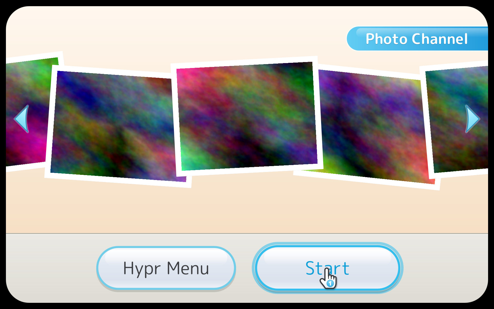

# Channel preview and launching

Clicking a channel doesn't start it right away. Like on the Wii:

1. The tile **grows** from its place in the grid into a rounded "TV" panel
   that nearly fills the screen; everything around it goes black. The whole
   panel grows as one piece, band and buttons included.
2. The panel shows the channel's art, with the channel's name in a **blue tab
   at the top right**. A **beige band** along the bottom holds two wide glossy
   pills: **`<brand> Menu`** (shrink back to the grid) and **Start**. If the
   app is already running, Start says **Resume**.
3. **Start is greyed out** (no hover, no click, Enter does nothing) when the
   channel has nothing to start: no command, no desktop entry and no open
   window. The Music Channel without an `app`/`exec` is one example.
4. Big blue arrows just inside the panel's edges step to the previous or next
   channel.
5. **Start** fades the screen to white, then:
   - if a window of the channel is open, it is activated (Hyprland jumps to
     its workspace);
   - otherwise the channel's command runs through `wii launch`, which opens it
     on a fresh, empty workspace.
   The preview then resets quietly behind the new window, so the menu is
   normal when you come back with SUPER.



Keyboard in the preview: **Esc** back, **Enter** start, **←/→** other channels.

## Running indicator
A tile shows a small blue dot when one of its windows is open. Windows are
matched by Wayland app id against:
- the channel's `class` regex, if set; otherwise
- the desktop entry id, the `app` value, and the first word of `exec`.

Set `class` when an app's window id differs from its desktop file
(e.g. `"class": "^(Code|codium)$"`).

## Code
| File | Role |
|---|---|
| `services/Launcher.qml` | desktop entry lookup, running detection, `canStart()`, `start()` |
| `services/Menu.qml` | `menu` IPC: `open <slot>`, `start`, `step <1 or -1>`, `close`, `next`, `prev`, `page <n>`, `state` |
| `home/ChannelPreview.qml` | zoom animation, TV panel, title tab, band, arrows, white fade |
| `home/PillButton.qml` | glossy pills (preview and message board); `available: false` greys one out |
| `channels/ChannelArt.qml` | picks the art for a channel type (used by tiles and the preview) |

## Testing without touching your real session
`dev/nested.sh` sets `WIIPERLAND_CONFIG=dev/test-config.json`, a channel list
with apps that open their own instance (`gnome-text-editor --standalone`,
`cool-retro-term`), so test launches don't open windows in your real desktop.

```bash
dev/run.sh bin/wii ipc menu open 0   # zoom into slot 0
dev/run.sh bin/wii ipc menu step 1   # right arrow: next channel (-1: previous)
dev/run.sh bin/wii ipc menu start    # press Start
dev/run.sh bin/wii home              # back to the menu
dev/hover.sh 1270 1040               # hover Start (1920x1200)
```

## Layout numbers
Measured from the reference recording, as shares of the screen:

| Part | Size |
|---|---|
| Panel inset | 1.2% of the width left and right, 2% of the height top and bottom |
| Panel corner radius | 7.8% of the panel's height |
| Beige band | bottom 23.5% of the panel |
| Pills | 29% of the panel's width, 14.8% of its height, 4.5% apart |
| Arrows | 5% × 9.2% of the screen height, at 38% of the panel's height |
| Title tab | 8.8% of the panel's height, 6.5% down from the top |

The preview art of the Photo Channel drops its own orange title strip, since
the tab carries the name.

## Tested
In `dev/nested.sh --headless 1920x1200`:
- `menu open 0` and `menu open 3`: mid-zoom and final frames captured; the
  panel grows as a whole with live-looking (not greyed) pills.
- `menu step 1` / `menu step -1`: steps through Text Editor, Retro Term,
  Photo, Forecast and Music.
- Music Channel (nothing to start): Start is grey, `menu start` does nothing.
- `dev/hover.sh` on Start and on an arrow: blue rim, glow and growth.
- `menu start` on the Text Editor channel: white fade, window opened on
  workspace 2. After `wii home`, opening it again shows **Resume**.
- `menu close`: shrinks back to the grid.
- The message board's pills (same component) still look right.
- Clicking the pills and arrows, and the keyboard shortcuts in the preview,
  can't be injected into the nested session; they need a check on real
  hardware.
